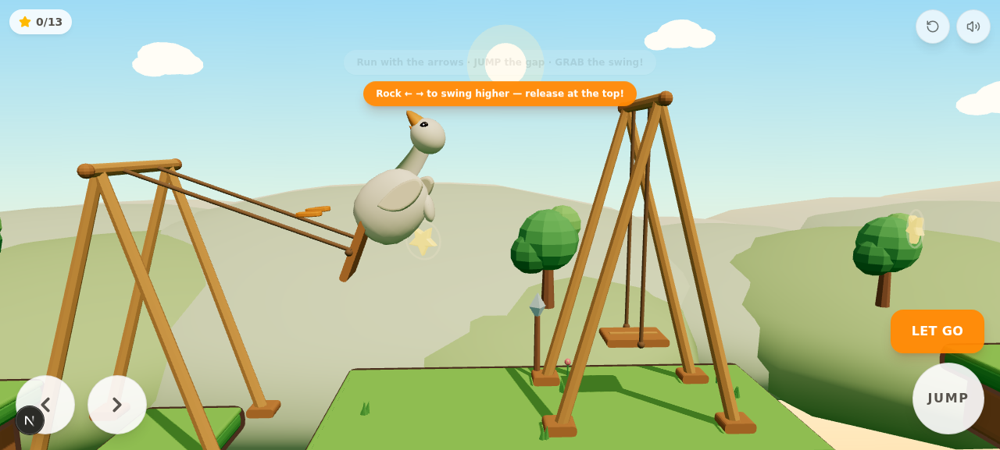

# Project Duck — V0.4

A charming, **swing-chain 2.5D fantasy platformer** starring a smooth, collectible-toy white
duck, built for mobile (Android-first) play in the browser. The duck matches the supplied
ornament reference: long elegant neck, softly rounded head, big friendly orange beak, glossy
bead eyes with catchlight, tiny folded wings and small orange webbed feet.



## Engine

Same as V0: **Three.js (real 3D) + a custom 2D-plane physics controller** on Next.js/TypeScript —
instantly playable in any browser, deterministic fixed-timestep sim (1/60) that can be tested
headlessly, and the duck exports to **`download/duck.glb`** for future Godot/Unity/Blender use.
The Android packaging path (Capacitor) is documented at the bottom.

## Run it

```bash
bun install
bun run dev        # dev server (the sandbox runs this automatically on port 3000)
```

Desktop keyboard works for development: **← → / A D** run · **Space / ↑ / W** jump ·
**E / Enter** grab & let go · **R** quick retry (respawn at checkpoint).

Touch: ← → buttons bottom-left · big **JUMP** bottom-right · contextual **GRAB / LET GO**
button appears near swings. All buttons use per-pointer capture so run + jump + grab
multi-touch combinations work.

## The loop (swing chain)

**Run → Jump → Grab → Pump → Release → Fly → Land → Run → Grab the next swing.**

Nine swings across one continuous route; you can detach mid-air and grab the next swing
without touching ground (verified S4 → S5 hanging-vine chain).

## The route (~110 units, sections A–E)

| Section | Content |
|---------|---------|
| **A — Warm-up** | Safe start meadow, sign, **S1** on a rock pedestal over the first gap (lands even with no pumping), wide landing platform, first checkpoint |
| **B — Swing rhythm** | **S2** and **S3**, two consecutive on-platform A-frames; light pumping required; momentum-focused gaps |
| **C — Floating islands** | **S4** pedestal swing down to a low isle, **S5** hanging vine swing over a wide gap (strong S4 releases chain onto it **mid-air**), **S6** up to the high crystal island; alternate jump route to P7 |
| **D — Fantasy garden** | Drop-jump into the garden (giant flowers, mushrooms, waterfall, pink trees), **S7** garden vine swing, **S8** with the **P9b bonus island** catching strong sends (optional harder route), lanterns |
| **E — Finish** | **S9** grand finale, pennant arch, flag → completion screen with star count + confetti |

Checkpoints: 9 crystal posts — one activates per platform landed; respawning is instant,
soft-flashed, and keeps collected stars. Quick retry button (top-right) returns to the
latest checkpoint; PLAY AGAIN (on the completion screen) restarts the whole level.

## What changed in V0.4

### Swing chain system
- 9 independent swings, each with its own pivot, rope length, damping, grab radius and a
  **max tangential speed cap** (`maxV`, default 11.5 m/s) so long ropes can't launch rockets
- **Inelastic angular stops** at ±1.38 rad — no rattle, no energy gain at the limits
- Released swings **keep settling + breeze sway** (V0.4 fixed released swings never losing
  energy — they used to spin forever and their seats never came back into grab range)
- Short re-grab cooldown (0.24 s) only on the swing you just left, so flying past it doesn't
  re-attach while any other swing stays grabbable for mid-air chains
- **Ahead-bias grab selection**: while moving, the swing in front of you is preferred over a
  seat swooping in from behind
- Release velocity comes from the seat's tangential velocity (preserved through the air,
  momentum guard intact), plus a small forward kick that rewards well-timed releases

### Feedback & game feel
- Grab ring + GRAB button, seat bump + sparkles + sfx on grab, gold rope/seat glow while
  attached, whoosh at the bottom of fast arcs, LET GO prompt, dust + squash on landings
- Footstep ticks alternate with the run cycle; checkpoint chime; star pickup blip
- Confetti bursts on star pickup, checkpoint celebrate, and the flag (three bursts)

### Checkpoints, stars, progression
- 9 explicit checkpoint posts (crystal turns gold when active); activation = landing on the
  platform, so flying over a post can't skip it
- 13 optional golden stars placed along verified swing arcs (all 13 collected during the
  automated full-route run); HUD counter with best-star persistence
- `localStorage` (`duck-save-v1`) stores `{completed, bestStars}` — nothing else, no accounts
- Completion screen: star count, best, PLAY AGAIN (full reset)

### Duck animation
- Jump anticipation (compress-then-rebound), checkpoint celebration (wing flaps + squint +
  hop wiggle), cute respawn recovery (dizzy wobble + head shake)
- All V0.2 animation retained: breathing, run cycle, hanging pose, pendulum tilt, wing
  flaps, landing nod, curiosity tilts, victory celebration, wind streaks
- Collider remains fully independent of all visual animation

### World
- 12 floating islands + 2 rock pedestals + 1 bonus island, cartoon outlines, lit rims
- Fantasy garden: oversized flowers, dotted mushrooms, pink whimsical trees, pastel rocks,
  a shimmering waterfall with falling droplets, hanging lanterns, glowing pulsing crystals
- Finish arch with pennants; background extended (more hills/clouds) for the longer route

### Camera
- Velocity-smoothed look-ahead (anticipates launches and fast flights, no oscillation)
- Pull-back while swinging, down-range look while airborne — landing targets stay visible

## Project structure

```
src/components/game/
  GameCanvas.tsx            React shell: canvas + touch UI + HUD + tips + completion screen
  engine/
    Game.ts                 orchestrator: loop, controller, camera, swing chain, checkpoints,
                            stars, confetti, persistence callbacks, debug/test hook
    Physics.ts              AABB world, substepped axis-separated collision + corner forgiveness
    Input.ts                unified keyboard/touch input with edge-triggered presses
    Duck.ts                 smooth swept-surface duck + all procedural animation
    Swing.ts                frame + hanging swings, pendulum (stops, caps, damping), feedback
    Level.ts                sections A–E: platforms, swings, checkpoints, stars, decor
    Background.ts           sky, sun, layered hills, cloud sea, drifting clouds
    Sfx.ts                  WebAudio synth SFX (step/land/grab/whoosh/release/chime/collect/
                            sparkle/fall/win) + mute
scripts/game-tests.js       deterministic in-browser test harness (window.__duck.sim)
scripts/export-duck.ts      exports the duck to download/duck.glb
download/screens/           verification screenshots (v4-*)
```

## Android build (Capacitor)

```bash
bun add -d @capacitor/cli && bun add @capacitor/core @capacitor/android
npx cap init "Project Duck" com.example.projectduck --web-dir=.next/static  # or a static export dir
bun run build && npx cap add android
npx cap open android   # then Build > Generate Signed APK/AAB in Android Studio
```

For a quick test without Android Studio, the game is fully playable in mobile Chrome/Firefox;
add it to the home screen for a fullscreen, app-like experience.

## Actual tests performed (headless browser, agent-driven, deterministic `sim()` harness)

All via `scripts/game-tests.js` injected into the running page (`window.__T.all()`), plus
real pointer-event touch tests at 390×844:

1. **Warm-up (§12-1)**: run → jump → grab S1 → pump → release → landed x 16.3 on P2,
   checkpoint activated, star collected on the flight arc — PASS
2. **Same swing repeatedly (§12-2)**: grab/release/re-grab S2 three times (cooldown lets the
   seat settle between) — PASS
3. **Two different swings (§12-3)**: strong S4 release → **mid-air chain onto hanging S5** →
   landed on P6 — PASS
4. **Miss a swing (§12-4)**: ran off the start edge without grabbing → kill plane → respawned
   at the start with clean state — PASS
5. **Checkpoint respawn (§12-5)**: activated P3's checkpoint, walked off its edge, respawned
   exactly at the post (x 25.4), grounded, no stale swing attachment — PASS
6. **Full route (§12-6)**: all 9 swings + 2 plain jumps in order → flag → `won: true`,
   **13/13 stars**, 8 checkpoints activated — PASS
7. **Collectibles (§12-7)**: star counter increments on pickup with burst + sfx — PASS
8. **Restart (§12-8)**: PLAY AGAIN on the completion screen → spawn, cp −1, stars 0 — PASS
9. **Touch only (§12-9)**: 390×844 viewport; real pointer tap on JUMP launched the duck
   (y 2.04); held Move-right ran at 4.2 m/s and coasted down after release; all buttons
   present within safe areas — PASS
10. **High speed (§12-10)**: mid-flight screenshot after an S1 release (vx ≈ 9.5) — camera
    tracks with look-ahead, duck + next platform readable, no errors — PASS

Console clean; ESLint passes.

### Bugs found and fixed during this round
- **Released swings never settled** (settle was only called while attached) — they spun at
  cap omega forever and their seats never returned to grab range; settle now runs for all
  unattended swings every step
- **Angular stop rattle / pinned deadlock** — the ±1.38 rad clamp now zeroes the pushing
  omega (inelastic stop)
- **Rocket launches** — unbounded pumping on long ropes produced 20 m/s releases; every
  swing now caps tangential speed (maxV 11.5 m/s)
- **Accidental behind-the-back grabs** — grab selection now prefers the swing ahead of the
  duck's motion
- **Checkpoint posts could be overflown** — activation is now per-platform landing

## Remaining issues / known limitations

- Headless-browser sim time runs below real time (RAF throttling in the sandbox); real
  devices run at full 60 fps. All timing-sensitive tests use the deterministic `sim()` hook.
- No audio beyond the synthesized SFX set (no music), same scope boundary as before.
- The optional bonus island (P9b) is intentionally hard: it catches near-max S7/S8 sends;
  missing it costs nothing (P10 follows immediately).
- Swing creak is implemented as a soft whoosh at the bottom of fast arcs, not a continuous
  rope creak.
- Android device testing / performance profiling was NOT performed (no device in sandbox);
  the Capacitor path above is documented but untested on hardware.
