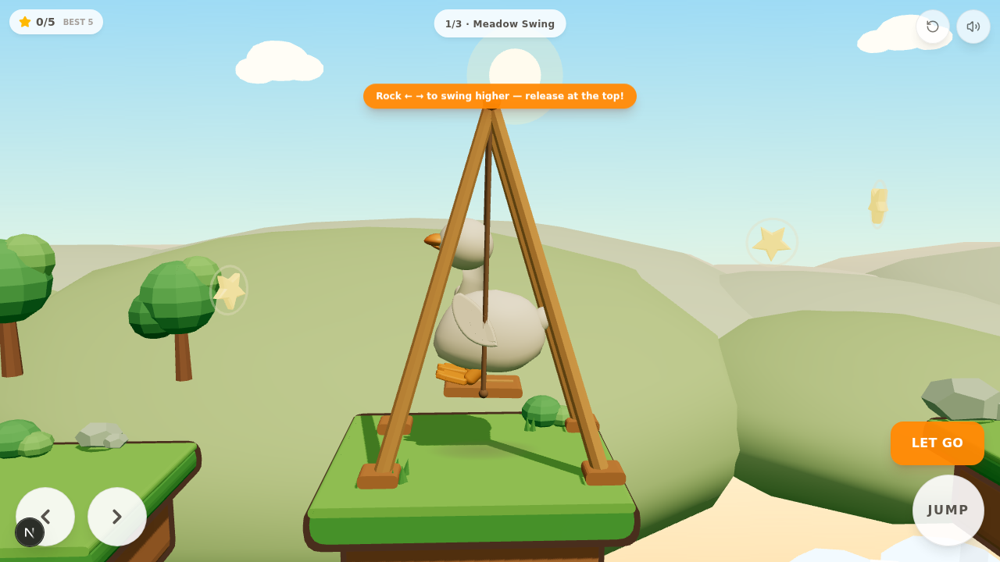

# Project Duck — V0.7

A charming, **level-based 2.5D fantasy platformer** starring a smooth, collectible-toy white
duck, built for mobile (Android-first) play in the browser. The duck matches the supplied
ornament reference: long elegant neck rising from the chest with a gentle S-sweep, softly
rounded head, a properly sculpted orange bill, glossy bead eyes with catchlight, folded
wings that hug the flank like real folded feathers, a perky lifted tail blended into the
body silhouette, and stubby orange legs with webbed feet.

V0.7 is a **quality iteration on the character and game feel**: a cohesive premium duck
model (no floating patches, no seams), a reworked upright swing perch, continuous
velocity-driven air poses, acceleration anticipation, idle life (tail flicks), new
restrained feedback (rope creaks, reach glints, jump puffs, checkpoint bursts), an
adaptive shadow budget for phones, and a swing-aware camera lead. All three V0.6 levels,
the physics constants and the controls are preserved untouched.



## Engine

Same as V0: **Three.js (real 3D) + a custom 2D-plane physics controller** on Next.js/TypeScript —
instantly playable in any browser, deterministic fixed-timestep sim (1/60) that can be tested
headlessly, and the duck exports to **`download/duck.glb`** for future Godot/Unity/Blender use.
The Android packaging path (Capacitor) is documented at the bottom.

## Run it

```bash
bun install
bun run dev        # dev server (the sandbox runs this automatically on port 3000)
```

Desktop keyboard works for development: **← → / A D** run · **Space / ↑ / W** jump ·
**E / Enter** grab & let go · **R** quick retry (respawn at checkpoint).

Touch: ← → buttons bottom-left · big **JUMP** bottom-right · contextual **GRAB / LET GO**
button appears near swings. All buttons use per-pointer capture so run + jump + grab
multi-touch combinations work (re-verified in V0.7 with a real pointer holding RUN while a
second synthetic touch tapped JUMP at 390×844).

## The loop (complete session)

**Start → run → jump → grab → pump → release → fly → collect → checkpoint → … → finish →
result screen → retry or next level.** Unchanged in V0.7 — this round deepened the *feel*
of every step instead of adding systems.

## Levels (unchanged from V0.6)

| # | Name | Theme | Teaching / challenge | Content |
|---|------|-------|----------------------|---------|
| 1 | **Meadow Swing** | sunny meadow | teach run, jump, grab, pump, release | teaching hop, 2 A-frame swings, wide landings, 1 checkpoint, 5 stars |
| 2 | **Floating Isles** | airy mint isles | reward momentum & good release timing | climb, long vine, **mid-air chain pair** (S3→S4), high/low routes, 2 checkpoints, 7 stars |
| 3 | **Crystal Canyon** | warm dusk canyon | demanding traversal | elevated swing, **moving ferry slab**, long vine, checkpoint before the hardest climb, **vertical elevator** to the spire, grand finale, 2 checkpoints, 6 stars |

Every platform, swing, mover and checkpoint transition was **reached and verified with the
deterministic sim harness** (see Tests). Physics constants are byte-identical to V0.6 —
reachability is untouched by design.

## What changed in V0.7

### Duck model v4 (Duck.ts)
- **Wings rebuilt**: the old wing patch floated above the back line and read as a sticker;
  the new almond wings sit low on the vertical flank, wrap around the body (yaw + roll),
  tip back-down toward the tail, and keep the layered covert for depth
- **Neck S-sweep**: the tube now starts deeper inside the chest with a flared base ring —
  the throat line is continuous (collar crease gone) — sweeps slightly back low, then arcs
  forward into the head like the ornament reference
- **Head & bill**: skull slightly larger and smoother (the neck tube buries deep inside),
  eyes repositioned outward to stay proud of the new skull, bill a touch longer with the
  same droop-curved two-mandible build
- **Tail blend**: smaller, tucked deeper into the lifted rear so it reads as part of the
  silhouette instead of a glued lump
- **Stubborn legs**: shorter, thicker thighs and higher ankles — the visible leg is stubbier
- **Materials**: body roughness/coat tuned to a silkier toy finish (softer clearcoat), feet
  matte slightly raised; hemisphere ground light warmed so the white belly no longer picks
  up a green cast over grass

### Animation (all procedural, physics never touched)
- **Sit pose reworked**: the V0.5 deep sink dropped the belly onto the plank and read as
  "face-down, butt up"; the duck now **perches on the seat** — feet at the plank edge, body
  upright along the rope, head lifted gracefully
- **Continuous air pitch**: airborne body lean now follows signed vertical velocity
  (rising noses slightly into the arc, falling eases into a belly-first glide) instead of
  a binary rising/falling flip — `DuckFrame.vy` was added (visual-only; collider blind)
- **Acceleration anticipation**: a smoothed acceleration signal leans the duck into
  take-offs from a standstill
- **Idle life**: occasional quick tail flick added to breathing/glance/curiosity
- **Fall panic**: wider wing flutter amplitude while dropping fast (plus the existing
  wide eyes), landing recovery unchanged (no lock)

### Swing & game feel
- **Rope creak**: a very quiet wooden creak while pumping hard or sweeping near the top of
  the arc (cooldown-gated)
- **Reach glint**: the first moment a swing comes into grab range it gives a soft
  two-note glint and a 4-spark shimmer at the seat — edge-triggered with a cooldown so
  cruising past swings never turns into a siren
- **Jump puff**: two dust motes on real ground takeoffs (not swing releases)
- **Checkpoint burst**: activating a post throws a small confetti burst at it
- **Sound variations**: footsteps and star pickups carry small random pitch variation;
  jump gained a whisper of takeoff texture; mute preserved

### Camera & performance
- **Swing lead**: while swinging, the camera leans slightly into the arc's travel
  direction so the landing zone stays readable through the widest sweep
- **Adaptive shadows**: phones (min viewport edge < 520 px) get a 1024² shadow map,
  desktops keep 2048²
- **Particle cap** (80) on the duck's dust/sparks/streaks so bursts can never stack up on
  weak devices
- Measured scene budget: **94 draw calls / ~22.6k triangles** (L1, mobile viewport) —
  light for any real GPU (see Tests for the honest measurement caveat)

### Preserved from V0.6 (untouched)
- Level data, LevelKit builders, themes, background palettes, movers + carrier physics
- Swing pendulum physics (caps, inelastic stops, damping, breeze), momentum-preserving
  releases, coyote time + jump buffering, air-momentum guard
- Save v2 progression, level picker, completion flow, tips, star/checkpoint HUD
- All V0.6 feedback (grab ring, seat bump, whoosh, confetti, chimes, footsteps)

## Project structure

```
src/components/game/
  GameCanvas.tsx            React shell: canvas + touch UI + HUD + level chip/picker +
                            intro cards + tips + completion flow + save v2
  engine/
    Game.ts                 orchestrator: loop, controller, camera (swing lead), swing
                            chain, movers, checkpoints, stars, confetti, reach glints,
                            creaks, loadLevel lifecycle, debug hook (+draw calls)
    Physics.ts              AABB world, substepped axis-separated collision, corner
                            forgiveness, moving-platform motions + carrier
    Input.ts                unified keyboard/touch input with edge-triggered presses
    Duck.ts                 sculpted collectible-figure duck (v4) + procedural animation
    Swing.ts                frame + hanging swings, pendulum (stops, caps, damping), dispose
    Level.ts                buildLevelRuntime: def → scene, stars, checkpoints, flag; dispose
    LevelKit.ts             reusable level builders + themes (meadow / isles / canyon)
    levels.ts               the three LevelDefs (pure data + decor placement)
    Background.ts           sky, sun, layered hills, cloud sea — themeable per level
    Sfx.ts                  WebAudio synth SFX (+creak/glint, variations) + mute
scripts/game-tests-v6.js    deterministic per-level test harness (window.__T, sim-based)
scripts/export-duck.ts      exports the duck to download/duck.glb
download/screens/v7/        V0.7 verification screenshots (base-*, m1..m3 iterations, qa-*)
```

## Android build (Capacitor)

```bash
bun add -d @capacitor/cli && bun add @capacitor/core @capacitor/android
npx cap init "Project Duck" com.example.projectduck --web-dir=.next/static  # or a static export dir
bun run build && npx cap add android
npx cap open android   # then Build > Generate Signed APK/AAB in Android Studio
```

For a quick test without Android Studio, the game is fully playable in mobile Chrome/Firefox;
add it to the home screen for a fullscreen, app-like experience.

## Actual tests performed (headless browser, agent-driven, deterministic `sim()` harness)

All via `scripts/game-tests-v6.js` injected into the running page. `window.__T.all()` runs
every scenario; the L3 finale is driven by a state machine (`l3_part1` + `l3_drive`).
Results from this round (V0.7 build):

| # | Scenario | Result |
|---|----------|--------|
| 1 | **L1 full**: teaching hop → S1 → wide landing → checkpoint → S2 → flag | PASS — won, **5/5 stars** |
| 2 | **L1 checkpoint**: fall after P2 → respawn exactly at the post | PASS — cp 0, grounded at post |
| 3 | **L2 full**: S1 climb → S2 vine → S3 → S4 → S5 climb → flag | PASS — won, 3/7 stars, cp 1 |
| 4 | **L2 mid-air chain**: hard S3 release → grab S4 while airborne → land P5 | PASS — chained, landed 53.1 |
| 5 | **L3 movers**: ferry M1 (wait → board → **carried** right → hop off) | PASS — landed P3 |
| 6 | **L3 checkpoint**: fall off P5 → respawn at the pre-finale post | PASS — cp 1, grounded at post |
| 7 | **L3 full**: S1 → M1 → S2 → S3 → checkpoint → M2 elevator → spire → S4 finale → flag | PASS — **won**, landed 70.7 |
| 8 | **Cross-level**: win L1 → loadLevel(1) → pristine state; back; same-level reload ×2 | PASS — no stale state |
| 9 | **Reset loop**: 6× (3 grab/release cycles + fullReset) | PASS — bounded, no NaN |
| 10 | **Touch multi-input** (390×844): real pointer holds RUN, synthetic second finger taps JUMP | PASS — run continues (vx 4.2) while jump fires (vy 8.2, airborne) |

Visual QA (download/screens/v7/qa-*): L1 idle / run / jump / swing perch / release flight /
landing, L2 isles theme, L3 canyon theme, victory, mobile portrait. Fresh reload console is
clean; ESLint and tsc (game sources) pass.

### Harness bugs found and fixed this round (pre-existing in the V0.6 commit)
- **l3_drive phase 1–2 could never board the elevator** — phase 1 tapped jump standing
  still but phase 2 required landing at x>52.6 (impossible without horizontal input); the
  boarding hop now holds RIGHT. Manual verification confirmed the game itself was fine.
- **l3_drive phase 6 could deadlock on a leftward pump peak** — it exited on
  `|omega| ≥ 2.5` while `releaseWhen` requires omega > +2.0; now exits on positive omega
  only. After both fixes the committed harness completes L3 for the first time (won=true).

### Performance measurement (honest numbers)
- Headless sandbox rendering is **software-rasterized** (SwiftShader): measured ~9 fps at
  390×844 and ~3.5 fps at 1280×720 — fill-rate-bound CPU rendering, **not representative of
  any real device GPU**; no real-device measurement was possible in this sandbox.
- Scene budget at the mobile viewport: 94 draw calls, ~22.6k triangles, one 1024² shadow
  map (adaptive), pixel ratio capped at 2, particles capped at 80. No per-frame allocation
  beyond short-lived particle materials (already pooled geometries, shared geos).

## Remaining issues / known limitations

- All three levels are fully verified by the sim harness; feel-tuning judgments (pose
  aesthetics, effect restraint) are based on screenshots and sim review, **not human
  playtest sessions**.
- **Android device testing was NOT performed** (no device in sandbox); the Capacitor path
  above is documented but untested on hardware, and the fps numbers above are
  software-renderer numbers, not device frame rates.
- No music (synthesized SFX only), same scope boundary as V0.5/V0.6.
- The duck's GLB export (download/duck.glb) was re-generated for the v4 model; export
  excludes the canvas-based contact shadow by design (DOM guard for non-DOM runtimes).
- The idle "weight shift" mentioned in earlier plans was superseded by the tail flick +
  existing glance/curiosity set (kept the idle restrained rather than adding motion).
