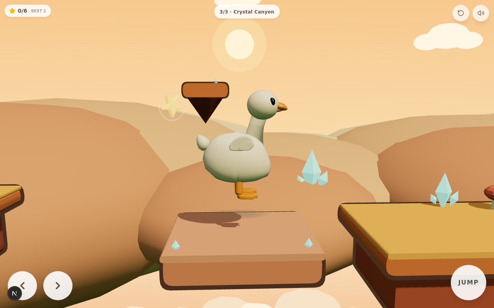

# Project Duck — V0.6

A charming, **level-based 2.5D fantasy platformer** starring a smooth, collectible-toy white
duck, built for mobile (Android-first) play in the browser. The duck matches the supplied
ornament reference: long elegant neck rising from the chest, softly rounded head, a properly
sculpted orange bill, glossy bead eyes with catchlight, layered folded wings, a perky lifted
tail that is part of the body silhouette, and stubby orange legs with webbed feet.

V0.6 turns the V0.5 foundation into a **complete, replayable game**: three hand-designed
levels (Meadow Swing → Floating Isles → Crystal Canyon), moving stone platforms, a full
completion flow with unlock progression, per-level star records, and a level picker.



## Engine

Same as V0: **Three.js (real 3D) + a custom 2D-plane physics controller** on Next.js/TypeScript —
instantly playable in any browser, deterministic fixed-timestep sim (1/60) that can be tested
headlessly, and the duck exports to **`download/duck.glb`** for future Godot/Unity/Blender use.
The Android packaging path (Capacitor) is documented at the bottom.

## Run it

```bash
bun install
bun run dev        # dev server (the sandbox runs this automatically on port 3000)
```

Desktop keyboard works for development: **← → / A D** run · **Space / ↑ / W** jump ·
**E / Enter** grab & let go · **R** quick retry (respawn at checkpoint).

Touch: ← → buttons bottom-left · big **JUMP** bottom-right · contextual **GRAB / LET GO**
button appears near swings. All buttons use per-pointer capture so run + jump + grab
multi-touch combinations work (verified by simulated touch at 390×844).

## The loop (complete session)

**Start → run → jump → grab → pump → release → fly → collect → checkpoint → … → finish →
result screen → retry or next level.** Every step of the §1 loop is implemented and verified.

## Levels

| # | Name | Theme | Teaching / challenge | Content |
|---|------|-------|----------------------|---------|
| 1 | **Meadow Swing** | sunny meadow | teach run, jump, grab, pump, release | teaching hop (impossible-to-miss gap), 2 A-frame swings over 4.2u gaps, wide landings, 1 checkpoint, 5 stars |
| 2 | **Floating Isles** | airy mint isles | reward momentum & good release timing | climb to a high isle, long hanging vine over an 8.4u gap, **mid-air chain pair** (S3→S4, verified), low/high route split, climb to a high finish, 2 checkpoints, 7 stars |
| 3 | **Crystal Canyon** | warm dusk canyon | demanding traversal | elevated pedestal swing, **moving ferry slab** across a 7u gap, long vine to a deep narrow ledge, checkpoint **right before the hardest section**, **vertical elevator slab** up to the crystal spire, grand finale swing, 2 checkpoints, 6 stars |

Every platform, swing, mover and checkpoint transition was **reached and verified with the
deterministic sim harness** (see Tests). No blind jumps, no perfect-timing requirements:
every release window is ≥0.3 rad wide and every catch platform is generously sized.

## Level architecture (V0.6)

```
levels.ts    LevelDef[]  — pure data: platforms, movers, swings, checkpoints, stars,
             spawn/flag/kill, theme id, hint + a buildDecor() placement function
LevelKit.ts  reusable builders — island, pedestal, movingPlatform, checkpointPost,
             star, finishFlag/arch, startSign + decor (tree, bush, flower, bigFlower,
             mushroom, crystal, rock, lantern, waterfall, floatingRock) + 3 themes
Level.ts     buildLevelRuntime(scene, world, def) — instantiates a def under one root
             group; update(t) animates; dispose() frees every geometry/material
Game.ts      loadLevel(i): tears the previous level down completely (scene objects,
             swings, physics boxes, progression, input) then builds fresh — repeated
             switching/restarts can never leak state; one Game instance per session
Physics.ts   moving platforms: sinusoidal one-axis motion advanced once per fixed step;
             a grounded body rides its carrier by the platform's exact delta
Background.ts  applyTheme(): meadow / isles / canyon palettes (sky gradient, fog, hill
             rings, sun, cloud sea) rebuilt per level, old layers disposed
```

Adding a level 4 = one new `LevelDef` entry + a decor function. No engine changes.

## What changed in V0.6

### Level system (replaces the hard-coded V0.4 route)
- `Level.ts` was one ~110u hard-coded route with module-level constants; it is now a
  **runtime built from data** (`levels.ts` + `LevelKit.ts` builders), fully disposable
- **Three complete levels** built and verified; L2's chain pair reuses the V0.4-verified
  8.6u chain geometry; L1 is a distilled teaching route
- **Moving platforms**: `PhysicsWorld.addMoving` + carrier-based riding (deterministic
  under the fixed timestep; horizontal ferry + vertical elevator in L3)
- **Per-level themes** for platforms, decor and the entire background palette

### Completion flow & progression
- Save v2 (`duck-save-v2`): highest unlocked level + per-level `{completed, bestStars,
  bestTime}`; unlocking is linear (finish a level → next unlocks)
- Completion screen: level name, stars, time, best stars + fastest time, **NEXT LEVEL** /
  **RETRY LEVEL**; after the final level: **ALL LEVELS COMPLETE!** + PLAY AGAIN
- Level intro card (name + one-line hint) fades in at every level start
- Compact level picker (tap the top-center chip): unlocked levels show best stars,
  locked ones show a lock icon

### Game feel fixes found by testing
- **Momentum-scaled regrab cooldown**: the just-released swing now stays locked for up to
  ~0.8s after a hard launch (it used to re-grab the duck mid-flight 0.24s after release),
  while weak drops re-grab snappily — this is what makes the L2 mid-air chain reliable
- L2/L3 geometry tuned until every transition verified (L3 spire made 0.6u closer after
  the elevator edge-jump test exposed a blind jump)

### Preserved from V0.5 (untouched)
- The collectible-figure duck model v3 and all procedural animation, including the
  swing-sit pose and release fling
- Swing pendulum physics (caps, inelastic stops, damping, breeze), momentum-preserving
  releases, coyote time + jump buffering, air-momentum guard
- All feedback: grab ring, seat bump, sparkles, whoosh, dust, confetti, chimes, footsteps
- Camera look-ahead, pull-back while swinging, portrait fit

## Project structure

```
src/components/game/
  GameCanvas.tsx            React shell: canvas + touch UI + HUD + level chip/picker +
                            intro cards + tips + completion flow + save v2
  engine/
    Game.ts                 orchestrator: loop, controller, camera, swing chain, movers,
                            checkpoints, stars, confetti, loadLevel lifecycle, debug hook
    Physics.ts              AABB world, substepped axis-separated collision, corner
                            forgiveness, moving-platform motions + carrier
    Input.ts                unified keyboard/touch input with edge-triggered presses
    Duck.ts                 sculpted collectible-figure duck (v3) + procedural animation
    Swing.ts                frame + hanging swings, pendulum (stops, caps, damping), dispose
    Level.ts                buildLevelRuntime: def → scene, stars, checkpoints, flag; dispose
    LevelKit.ts             reusable level builders + themes (meadow / isles / canyon)
    levels.ts               the three LevelDefs (pure data + decor placement)
    Background.ts           sky, sun, layered hills, cloud sea — themeable per level
    Sfx.ts                  WebAudio synth SFX + mute
scripts/game-tests-v6.js    deterministic per-level test harness (window.__T, sim-based)
scripts/export-duck.ts      exports the duck to download/duck.glb
download/screens/           verification screenshots (v4-*, v5-*, v6-*)
```

## Android build (Capacitor)

```bash
bun add -d @capacitor/cli && bun add @capacitor/core @capacitor/android
npx cap init "Project Duck" com.example.projectduck --web-dir=.next/static  # or a static export dir
bun run build && npx cap add android
npx cap open android   # then Build > Generate Signed APK/AAB in Android Studio
```

For a quick test without Android Studio, the game is fully playable in mobile Chrome/Firefox;
add it to the home screen for a fullscreen, app-like experience.

## Actual tests performed (headless browser, agent-driven, deterministic `sim()` harness)

All via `scripts/game-tests-v6.js` injected into the running page (per-scenario calls;
`window.__T.all()` runs everything except the two long L3 legs, which are split into
`l3_part1` + `l3_drive` to stay under the CLI eval time limit). Results from this round:

| # | Scenario | Result |
|---|----------|--------|
| 1 | **L1 full**: teaching hop → S1 → wide landing → checkpoint → S2 → flag | PASS — hop 10.4, S1→18.7, won, **5/5 stars** |
| 2 | **L1 checkpoint**: fall after P2 → respawn exactly at the post | PASS — cp 0, x 21.5, grounded |
| 3 | **L2 full**: S1 climb → S2 vine → S3 → S4 → S5 climb → flag | PASS — all four crossings landed inside windows, cp 1, **3/7 stars**, won |
| 4 | **L2 mid-air chain**: hard S3 release → grab S4 while airborne → land P5 | PASS — chain caught at x 44.7 (swingX verified = S4), landed 52.9 |
| 5 | **L3 movers**: ferry M1 (wait → board → **carried** right → hop off) | PASS — landed P3 24.7–26.3; carry asserted (duck x tracks platform) |
| 6 | **L3 checkpoint**: fall left of P5 → respawn at the pre-finale post | PASS — cp 1, x 49.2, grounded |
| 7 | **L3 full**: S1 → M1 → S2 → S3 → checkpoint → M2 elevator → spire → S4 finale → flag | PASS — M2→60.6, S4→67.1, **won** |
| 8 | **Cross-level**: win L1 → loadLevel(1) → pristine state; back to L1; same-level reload ×2 | PASS — level/x/stars/cp/swinging clean every time, no stale swing motion |
| 9 | **Reset loop**: 6× (3 grab/release cycles + fullReset) | PASS — no NaN, omega bounded, always grounded at spawn |
| 10 | **Touch only** (390×844): simulated taps on JUMP and Move-right | PASS — duck jumped (vy 3.7, airborne) and ran (x +0.22, facing 1) |

Visual QA (v6-01…v6-10): L1 meadow, L1 mid-swing with LET GO, L2 isles theme, L3 canyon
theme, **ferry mid-ride**, L3 swing sit on the canyon swing, level picker, completion card,
ALL-LEVELS-COMPLETE card, mobile portrait. Fresh reload console is clean; ESLint passes.

### Bugs found and fixed during this round
- **Hard releases re-grabbed the old swing mid-flight** (0.24s cooldown < time inside its
  grab zone) — cooldown now scales with release speed (up to ~0.8s); the L2 chain went
  from landing-back-on-P4 to a reliable mid-air S4 catch
- **L3 spire jump was blind** from the elevator center — the elevator is rideable to its
  right edge and the spire was moved 0.6u closer; the scripted ride now walks to the edge
  first (a human reads the same cue from the slab's crystal-pinned rim)
- **L1 teaching hop 0.01u out of reach** when jumping early — island moved 0.5u closer
- **L3 checkpoint fall landed on the elevator corner** instead of the kill plane (test
  design issue, right edge catches) — the respawn test now uses the guaranteed-empty left gap

## Remaining issues / known limitations

- Levels 2 and 3 are fully tested; every transition in all three levels is verified by the
  sim harness. Human-feel tuning (difficulty curve pacing) is based on these windows and
  screenshots, not on human playtest sessions.
- Headless-browser sim time runs below real time (RAF throttling in the sandbox); real
  devices run at full 60 fps. All timing-sensitive tests use the deterministic `sim()` hook.
- No audio beyond the synthesized SFX set (no music), same scope boundary as before.
- Android device testing / performance profiling was NOT performed (no device in sandbox);
  the Capacitor path above is documented but untested on hardware.
- The old V0.4 single-route level (9 swings, sections A–E) was replaced by the three new
  levels; its geometry survives distilled into L1/L2 (the V0.4-verified chain numbers are
  reused verbatim in L2).
