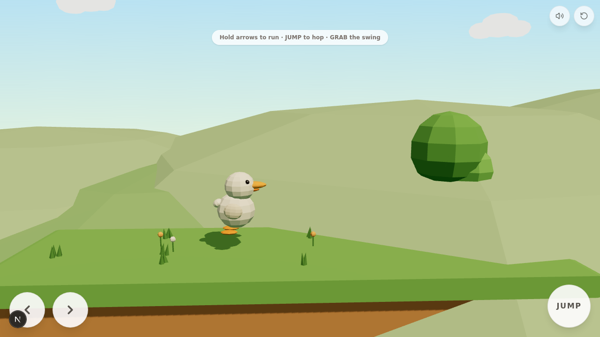

# Project Duck — V0

A small, polished, cute **2.5D physics platformer** starring a low-poly white duck on a swing,
built for mobile (Android-first) play in the browser. Visual identity is matched to the supplied
reference image: a white faceted duck with an orange beak, black bead eyes (with catchlight),
folded wings and short orange feet.



## Engine choice (as required by the brief)

The repository was empty and this sandbox has **no Godot runtime, display server or Android
export templates**, so a Godot project could not have been run, tuned or verified here. The brief
prioritises "the character looks right and feels wonderful to control" plus *actual tests*, so V0
uses **Three.js (real 3D) + a custom 2D-plane physics controller** on Next.js/TypeScript:

- true 2.5D: full 3D characters/environments, gameplay locked to a side-view plane
- instantly playable and verifiable in any browser, including Android Chrome
- deterministic fixed-timestep simulation (1/60) that can be tested headlessly
- the duck is exported to **`download/duck.glb`**, ready to import into Godot/Unity/Blender if
  the project later moves engines
- Android packaging path documented below (Capacitor)

## Run it

```bash
bun install
bun run dev        # dev server (the sandbox runs this automatically on port 3000)
```

Open the preview URL on a phone or desktop. Desktop keyboard works for development:
**← → / A D** run · **Space / ↑ / W** jump · **E / Enter** grab & let go · **R** restart.

## Test level (single course, side view)

start platform → 2 gaps → low obstacle to hop → 1 more gap → **the swing** over a wide gap
(too wide for a plain jump — grab it, pump with ←/→, release with JUMP/LET GO at the top of the
forward swing) → landing platform → step → **finish flag** with a victory celebration.
Falling out of the level softly respawns you at the start.

## Project structure

```
src/components/game/
  GameCanvas.tsx            React shell: canvas + touch UI + overlays
  engine/
    Game.ts                 orchestrator: loop, controller, camera, swing logic, debug hook
    Physics.ts              AABB world, substepped axis-separated collision, ground detection
    Input.ts                unified keyboard/touch input with edge-triggered presses
    Duck.ts                 procedural reference-matched duck + all procedural animation
    Swing.ts                swing model + pendulum (pivot, two ropes, seat, momentum)
    Level.ts                platforms, obstacle, decor, trees, flag (deterministic layout)
    Background.ts           gradient sky, clouds, parallax hills, fog
    Sfx.ts                  WebAudio synth SFX (jump/land/grab/release/fall/win) + mute
scripts/export-duck.ts      exports the duck to download/duck.glb
download/screens/           verification screenshots from the automated browser session
```

## Android build (Capacitor)

```bash
bun add -d @capacitor/cli && bun add @capacitor/core @capacitor/android
npx cap init "Project Duck" com.example.projectduck --web-dir=.next/static  # or a static export dir
bun run build && npx cap add android
npx cap open android   # then Build > Generate Signed APK/AAB in Android Studio
```

For a quick test without Android Studio, the game is fully playable in mobile Chrome/Firefox;
add it to the home screen for a fullscreen, app-like experience (viewport and safe-area
handling are already configured).

## Completed features (V0 scope)

- Reference-matched procedural duck asset (separate visual root vs physics AABB; squash &
  stretch never touches collision)
- Idle breathing + blinking, run cycle (bounce, lean, feet), air dangle, sit pose, dust puffs,
  squash & stretch on jump/land
- Movement: accel/decel, jump (coyote time + input buffering, no double jump), gravity, landing
  recovery
- Physics: substepped AABB sweep (no tunneling), reliable ground probe, kill-plane respawn
- One swing: grab prompt, pendulum with directional pumping, momentum-preserving release with a
  small forward kick
- Touch controls: left/right buttons, JUMP, contextual GRAB / LET GO; multi-touch via pointer
  capture; mute + restart; keyboard for dev
- One short test level with gaps, obstacle, swing crossing and finish flag
- Tiny synth SFX, sunny-meadow art direction, fixed side-view camera with soft follow

## Actual tests performed (headless browser, agent-driven)

Screenshots in `download/screens/`:

1. Idle render at gameplay camera distance — duck readable, scene composed (01, 11)
2. Run: reached max speed 4.2, onGround stable, run pose captured (02)
3. Jump: airborne state, apex ~2.0 m, clean landing (03)
4. Swing: GRAB prompt appears, grab converts momentum to pendulum, duck sits like the
   reference (04); pumping builds amplitude (06)
5. Release: tangential momentum preserved mid-flight (05, 07 trace); duck crosses the wide gap
   and lands on the far platform (state x≈44.2, onGround)
6. Fall recovery: falling into the gap respawns at start with flash (observed twice)
7. Flag: victory triggers with celebration overlay (09)
8. Mobile portrait 390×844: controls sized correctly, view fits (10)
9. Console clean (no errors) after fixes; ESLint passes

## Remaining issues / known limitations

- Sim speed in the sandbox's headless browser runs below real time (RAF throttling) — real
  devices run at full 60 fps; nothing to fix in game code
- The blind auto-play bot can't time the obstacle hops like a human; every mechanic was instead
  verified piecewise (see tests)
- Swing crossing needs a modestly well-timed release (θ≈0.7–1.0 of the forward swing); casual
  testers may need a few attempts — respawn is fast
- No gamepad support, no level progression, no music — intentionally out of V0 scope
- Godot port not included (engine decision documented above); the duck.glb asset is engine-ready
