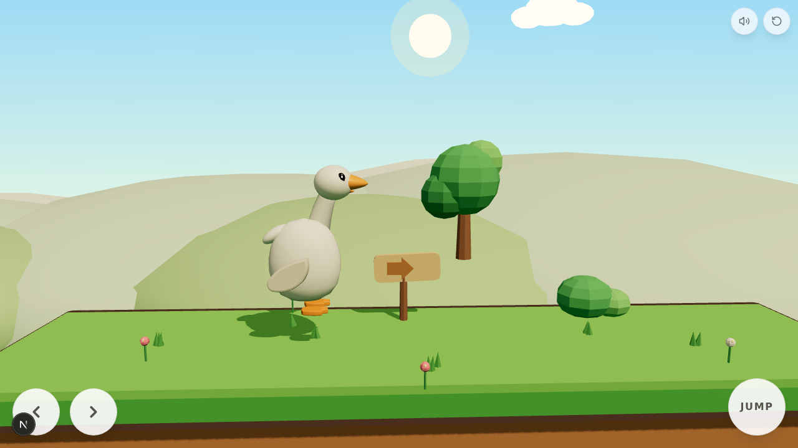

# Project Duck — V0.2

A charming **swing-first 2.5D physics platformer** starring a smooth, collectible-toy white
duck, built for mobile (Android-first) play in the browser. The duck matches the supplied
ornament reference: long elegant neck, softly rounded head, big friendly orange beak, glossy
bead eyes with catchlight, tiny folded wings and small orange webbed feet.



## Engine

Same as V0: **Three.js (real 3D) + a custom 2D-plane physics controller** on Next.js/TypeScript —
instantly playable in any browser, deterministic fixed-timestep sim (1/60) that can be tested
headlessly, and the duck exports to **`download/duck.glb`** for future Godot/Unity/Blender use.
The Android packaging path (Capacitor) is documented at the bottom.

## Run it

```bash
bun install
bun run dev        # dev server (the sandbox runs this automatically on port 3000)
```

Desktop keyboard works for development: **← → / A D** run · **Space / ↑ / W** jump ·
**E / Enter** grab & let go · **R** restart.

## The loop (swing-first)

**Run → Jump → Grab → Swing → Release → Fly → Land → Repeat.**

The level is built around two playground swings:

start platform → **swing A** over a gap that is too wide to jump → landing platform →
**swing B** (longer ropes, bigger arc) over a wider gap → final island with a sandy mound to
hop and the **finish flag**. Falling softly respawns you at your **last comfortable landing**
(soft checkpoint), not the level start.

## What changed in V0.2

### Character
- Duck rebuilt from smooth swept surfaces (lathe body profile + custom tapered-tube neck +
  lathe beak halves) — no visible primitive stacks, no flat shading on the character
- MeshPhysicalMaterial with light clearcoat for a soft toy sheen; separate materials for
  body, wings, beak, feet and eyes; collider still fully independent of the visual mesh
- More animation: run lean/bounce with neck counter-sway, wing flaps in the air, wings hold
  the ropes while sitting, legs lag the pendulum while swinging, pumping rocks the neck,
  landing head-nod spring, curiosity head-tilts while idle, happy squint + wing flaps on
  victory, wind streaks during fast flight, sparkle burst on grab

### Level & readability
- Platforms rebuilt as floating meadow islands: saturated two-tone grass caps with a pale lit
  rim, warm earth bodies, hanging island bottoms and dark cartoon outlines — nothing shares a
  color or silhouette with the hills behind them; collision boxes match the visible caps
- Background rebuilt as deliberate depth layers: soft sun (slow parallax), three rings of
  progressively paler hills, drifting clouds, and a cloud sea far below the gaps so falling
  reads as diving into clouds; fog tuned so gameplay islands stay crisp
- Trees/bushes pushed behind the play plane so they never fight the duck for attention

### Swing feel
- Classic A-frame playground swing (readable "A" silhouette), warm wood, thicker ropes,
  per-instance rope length/colors
- Forgiving grab: 2.1 u radius "magnet" — the seat snaps to the duck's angle on grab; a
  pulsing ring appears around the seat while in range and the seat does a happy bump
- Unattended swings settle with a whisper of breeze sway (and no longer freeze mid-air —
  fixed in V0.2)
- Swing-aware camera: pulls back slightly and looks down-range while swinging/flying so the
  landing area is visible before you commit to a release

### Systems
- Two swings with a nearest-grabbable selection; momentum-preserving release retained
- Soft checkpoint system (fresh landings well inside a platform update the respawn point)
- Physics fixes: the ground probe no longer eats landing events (dust/sfx/checkpoints fire
  reliably), and corner forgiveness stops the duck jamming on ledge corners
- One-shot teaching tips (e.g. "Rock ← → to swing higher" after your first grab)

## Project structure

```
src/components/game/
  GameCanvas.tsx            React shell: canvas + touch UI + tips + overlays
  engine/
    Game.ts                 orchestrator: loop, controller, camera, multi-swing logic, debug hook
    Physics.ts              AABB world, substepped axis-separated collision + corner forgiveness
    Input.ts                unified keyboard/touch input with edge-triggered presses
    Duck.ts                 smooth swept-surface duck + all procedural animation
    Swing.ts                A-frame swing, pendulum, grab ring, breeze sway
    Level.ts                floating-island platforms, decor, mound, flag (deterministic layout)
    Background.ts           sky, sun, layered hills, cloud sea, drifting clouds
    Sfx.ts                  WebAudio synth SFX (jump/land/grab/sparkle/release/fall/win) + mute
scripts/export-duck.ts      exports the duck to download/duck.glb
download/screens/           verification screenshots from the automated browser session
```

## Android build (Capacitor)

```bash
bun add -d @capacitor/cli && bun add @capacitor/core @capacitor/android
npx cap init "Project Duck" com.example.projectduck --web-dir=.next/static  # or a static export dir
bun run build && npx cap add android
npx cap open android   # then Build > Generate Signed APK/AAB in Android Studio
```

For a quick test without Android Studio, the game is fully playable in mobile Chrome/Firefox;
add it to the home screen for a fullscreen, app-like experience.

## Actual tests performed (headless browser, agent-driven)

Screenshots in `download/screens/` (v2-*):

1. Idle/run/jump poses with the new character; run speed 4.2 m/s, onGround stable
2. Run-jump-grab on swing A: momentum converts to pendulum (ω≈2.6 on catch)
3. Pumping builds ω to 4.4; sim-locked release crosses the 5.2 m gap; landed x≈17.2 on
   platform 2
4. Same for the longer swing B (ω 3.8+, release window 0.35–1.05 rad); crossed and flagged
5. **Full continuous playthrough**: grab A → cross → grab B → cross → mound → flag →
   `won: true` (v2-18)
6. Checkpoint system: fresh landings update the respawn point (verified 16.0 / 27.5 / 32.4);
   falling off a platform respawns there, not at the start
7. Physics regression fixed and verified: ground-probe landing events fire reliably; ledge
   corners no longer jam the duck (mound pass works at run speed)
8. Grab feedback: pulsing ring + GRAB button visible in range (v2-15); ring hides while
   swinging; LET GO button while swinging (v2-09)
9. Mobile portrait 390×844: controls sized correctly, island + cloud sea composition (v2-16)
10. Console clean; ESLint passes; duck.glb re-exported (210 KB)

## Remaining issues / known limitations

- Headless-browser sim time runs below real time (RAF throttling in the sandbox) — real
  devices run at full 60 fps; all timing-sensitive tests use sim-locked helpers
- The swing release still wants a modestly well-timed tap (release near the top of the
  forward arc); the camera pull-back and the tips make this discoverable
- No gamepad, level progression or music — same scope boundary as V0
