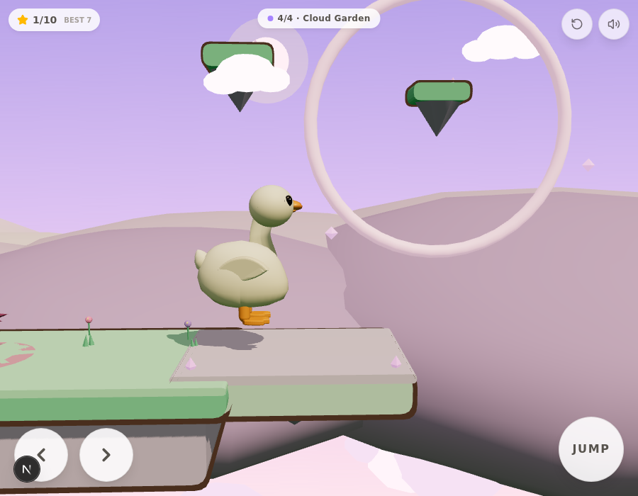

# Project Duck — V0.8

A charming, **level-based 2.5D fantasy adventure** starring a smooth, collectible-toy white
duck, built for mobile (Android-first) play in the browser. The duck matches the supplied
ornament reference: long elegant neck rising from the chest with a gentle S-sweep, softly
rounded head, a properly sculpted orange bill, glossy bead eyes with catchlight, folded
wings that hug the flank, a perky lifted tail blended into the silhouette, and stubby orange
legs with webbed feet.

V0.8 expands the game into **four connected fantasy regions** on one deliberate difficulty
curve — Enchanted Meadow → Floating Islands → Crystal Canyon → **Cloud Garden (new)** — and
adds the game's first real hazards, an expert-only shortcut route, fantasy landmarks
(suspended ring gates, glowing puff flora, background rope bridges), region identity in the
UI, and a fourth level finale built around a **double mid-air vine chain**. The duck model,
animation system, physics constants and controls are preserved untouched from V0.7.



## Engine

Same as V0: **Three.js (real 3D) + a custom 2D-plane physics controller** on Next.js/TypeScript —
instantly playable in any browser, deterministic fixed-timestep sim (1/60) that can be tested
headlessly, and the duck exports to **`download/duck.glb`** for future Godot/Unity/Blender use.
The Android packaging path (Capacitor) is documented at the bottom.

## Run it

```bash
bun install
bun run dev        # dev server (the sandbox runs this automatically on port 3000)
```

Desktop keyboard works for development: **← → / A D** run · **Space / ↑ / W** jump ·
**E / Enter** grab & let go · **R** quick retry (respawn at checkpoint).

Touch: ← → buttons bottom-left · big **JUMP** bottom-right · contextual **GRAB / LET GO**
button appears near swings. All buttons use per-pointer capture so run + jump + grab
multi-touch combinations work.

## The loop (complete session)

**Region intro → run → jump → grab → pump → release → fly → collect → hazard dodge →
checkpoint → … → finish → result screen → next region / replay.** Progress (unlocked
regions, per-region best stars & time) persists in localStorage (`duck-save-v2`, no accounts,
offline-friendly). Replaying a completed region never duplicates rewards — records are
best-value merges.

## The four regions

| # | Region | Theme | Teaching / challenge | Content |
|---|--------|-------|----------------------|---------|
| A | **Enchanted Meadow** (Meadow Swing) | sunny meadow | teach run, jump, grab, pump, release | teaching hop, 2 A-frame swings, wide landings, 1 checkpoint, 5 stars |
| B | **Floating Islands** (Floating Isles) | airy mint isles | reward momentum & release timing | climb, long vine, **mid-air chain pair** (S3→S4), high/low routes, 2 checkpoints, 7 stars |
| C | **Crystal Canyon** (Crystal Canyon) | warm dusk canyon | demanding traversal + the first hazards | elevated swing, **moving ferry slab**, long vine, **thorn burr hazard**, checkpoint before the hardest climb, **vertical elevator**, background rope bridge, 2 checkpoints, 6 stars |
| D | **Cloud Garden** (Cloud Garden) — *new* | dusk-magic lavender sky, mint grass on cloud-rock | combine everything: momentum, chains, movers, precision landings | teaching hop, climb swing, long vine, **walk-on lily ferry through a ring gate**, chain zone (S3→S4), **double-vine grand finale (S5→S6 mid-air chain)** through a second ring gate, **optional expert shortcut isle** (skips S6 entirely), thorn burr, 3 checkpoints, 10 stars |

Every platform, swing, mover, hazard and checkpoint transition in all four regions was
**reached and verified with the deterministic sim harness** (see Tests). Physics constants
are byte-identical to V0.7 — reachability of the existing three regions is untouched.

## What changed in V0.8

### Region D — Cloud Garden (new level, ~100u)
- 9 platforms + 1 mover + 6 swings over a lavender sky with a pink cloud sea, pale violet
  hill rings and drifting clouds; platforms are mint-capped cloud-rock with dark violet
  outlines so the white duck always pops.
- **Walk-on lily ferry**: the moving pad's top sits 0.02u above the wide garden so the duck
  *walks straight on* (no jump timing), rides through the first **ring gate**, and hops off
  at the far side. Falling is a soft recovery to the nearest checkpoint.
- **Chain zone**: pedestal swing → hard release → mid-air grab of the hanging vine, with a
  safe catch isle underneath for the fallback route.
- **Grand finale**: pump the long finale vine, release at mid-arc, **chain mid-air onto the
  short gate swing**, pump, and send the duck through the second ring gate onto the grand
  garden. Skilled players can instead release *early* at max pump to land the **shortcut
  isle** (2 stars) and leap straight to the garden, skipping the last swing entirely.

### Hazards (first in the game)
- **Thorn burr** — a slow-patrolling spiky ball (deep plum, spikes, pulsing red danger ring
  projected on the ground under it). Touching it = a soft "prick" (burst + quiet sfx + flash)
  and a respawn at the last checkpoint. Always placed on a wide platform with room to run
  past or hop over, always after a recent checkpoint. One in Crystal Canyon, one in Cloud
  Garden. No invisible collision, no cheap deaths.
- Wind gusts and enemy-style hazards were considered and deliberately **not** added
  (readability/fairness on touch, no suitable combat system exists — per spec).

### Fantasy landmarks & art direction
- **Suspended ring gates** (2 in Cloud Garden): giant glowing rings that frame the actual
  flight paths — the ferry drifts through one, the double-vine finale threads the other.
- **Glowing puff plants** and oversized flowers across the garden; a **background suspension
  bridge** in Crystal Canyon (InstancedMesh planks + tube rails, 5 draw calls).
- Region identity in the UI: colored region overlines on the intro card and every picker row
  (emerald / teal / orange / violet), plus a region dot on the level chip.
- Each region keeps a distinct palette (sunny greens / airy mints / warm dusk / dusk-magic
  lavender) over one shared art style: saturated caps, dark outlines, soft lighting,
  layered parallax hills, restrained particles.

### Traversal challenges (new swing content, physics untouched)
- **Long swing** (existing long vines), **elevated swing** (Canyon/Garden climbs),
  **swing chain** (Isles S3→S4, **Garden S3→S4 and S5→S6**), **moving-platform landing**
  (Canyon ferry/elevator, Garden lily ferry), and the new **optional shortcut** (Garden
  high isle, expert release line) — every one verified reachable via the sim harness.

## Project structure

```
src/components/game/
  GameCanvas.tsx            React shell: canvas + touch UI + HUD + level chip/picker +
                            intro cards + tips + completion flow + save v2
  engine/
    Game.ts                 orchestrator: loop, controller, camera (swing lead), swing
                            chain, movers, checkpoints, stars, hazards, confetti, glints,
                            creaks, loadLevel lifecycle, debug hook (+hazardX/hazardD)
    Physics.ts              AABB world, substepped axis-separated collision, corner
                            forgiveness, moving-platform motions + carrier
    Input.ts                unified keyboard/touch input with edge-triggered presses
    Duck.ts                 sculpted collectible-figure duck (v4) + procedural animation
    Swing.ts                frame + hanging swings, pendulum (stops, caps, damping), dispose
    Level.ts                buildLevelRuntime: def → scene, stars, checkpoints, hazards, flag
    LevelKit.ts             reusable builders + 4 themes (meadow/isles/canyon/garden) +
                            ring gates, puff plants, rope bridges, thorn burr
    levels.ts               the four LevelDefs (pure data + decor placement)
    Background.ts           sky, sun, layered hills, cloud sea — themeable per level
    Sfx.ts                  WebAudio synth SFX (+creak/glint/prick, variations) + mute
scripts/game-tests-v6.js    deterministic L1–L3 test harness (window.__T, sim-based)
scripts/game-tests-v8.js    V0.8 additions: L4 scenarios + crossLevel4 (extends T.all)
scripts/export-duck.ts      exports the duck to download/duck.glb
download/screens/v8/        V0.8 verification screenshots
```

## Android build (Capacitor)

```bash
bun add -d @capacitor/cli && bun add @capacitor/core @capacitor/android
npx cap init "Project Duck" com.example.projectduck --web-dir=.next/static  # or a static export dir
bun run build && npx cap add android
npx cap open android   # then Build > Generate Signed APK/AAB in Android Studio
```

For a quick test without Android Studio, the game is fully playable in mobile Chrome/Firefox;
add it to the home screen for a fullscreen, app-like experience.

## Actual tests performed (headless browser, agent-driven, deterministic `sim()` harness)

`scripts/game-tests-v6.js` (L1–L3, from V0.6/V0.7, ferry boarding + hop-off hardened this
round) plus `scripts/game-tests-v8.js` (L4 + crossLevel4) injected into the running page;
`window.__T.all()` runs all 14 scenarios. **Two consecutive full runs: ALL GREEN.**

| # | Scenario | Result |
|---|----------|--------|
| 1 | **L1 full**: teaching hop → S1 → wide landing → checkpoint → S2 → flag | PASS — won, **5/5 stars** |
| 2 | **L1 checkpoint**: fall after P2 → respawn exactly at the post | PASS |
| 3 | **L2 full**: S1 climb → S2 vine → S3 → S4 → S5 climb → flag | PASS — won, 3/7 stars |
| 4 | **L2 mid-air chain**: hard S3 release → grab S4 while airborne → land P5 | PASS — chained |
| 5 | **L3 movers**: ferry M1 (edge wait → board → **carried** → hop off) | PASS — landed P3 |
| 6 | **L3 checkpoint**: fall off P5 → respawn at the pre-finale post | PASS |
| 7 | **L3 full**: S1 → M1 → **burr hop** → S2 → S3 → checkpoint → M2 elevator → S4 finale → flag | PASS — **won**, 3/6 stars |
| 8 | **L4 part 1**: teaching hop → S1 climb (CP1) → long vine S2 → burr island | PASS — landed 34.7, safe of the burr |
| 9 | **L4 full**: hop → walk-on ferry → S3 → **mid-air chain S4** → S5 → **mid-air chain S6** → grand garden → flag | PASS — **won**, 6/10 stars, cp 2, both chains true |
| 10 | **L4 hazard**: safe standstill untouched for a full patrol; walking into the burr pricks + respawns at CP1 | PASS |
| 11 | **L4 checkpoint**: fall after CP3 → respawn at the post | PASS |
| 12 | **L4 shortcut**: expert early release lands the high isle (83.0–85.2) | PASS — via the release-window sweep |
| 13 | **crossLevel4**: win L1 → L4 pristine (hazards=1, swings=6) → back → reload ×2 | PASS — no stale state |
| 14 | **Reset loop**: 6× (grab/release cycles + fullReset) | PASS — bounded, no NaN |

Manual probes this round: multi-touch run+jump at 390×844 (run holds, jump fires), ferry
carrier ride sampled step-by-step (duck tracks the pad exactly), burr prick → checkpoint
respawn, release trajectory traces.

Visual QA (download/screens/v8/): garden start / burr isle / ferry + ring gate / finale
launch / grand garden / canyon burr + rope bridge / region picker / mobile 390×844. Fresh
reload console is clean; ESLint passes.

### Game & harness issues found and fixed this round
- **Moving-platform visuals floated ~0.33u** under the duck (cap center vs collision top
  mismatch, pre-existing since V0.6) — the kit now aligns the cap top with the collision top.
- **S1 climb wall-clip** (L4): the release trajectory hit the high garden's left wall face
  and lost all momentum mid-air — the platform was lowered to 1.0u so every honest release
  clears the lip; verified by trajectory trace.
- **Ferry boarding was jump-timing-fragile** → redesigned as a **walk-on pad** (0.02u lip,
  corner-forgiveness walk-on) — deterministic, no jump needed.
- **Burr vs pad overlap** (L4): the ferry's left extreme originally came within 0.4u of the
  burr patrol and pricked riding ducks — the pad travel was retuned.
- **L3 burr zone was wider than a jump arc** (2.64u vs 2.07u safe band — unhopppable) → the
  burr was lowered to a grounded thorn-bush look (top 1.34u) and its patrol tightened; the
  harness now hops it with a relative-distance trigger.
- **Harness**: ferry boarding/hop-off rewritten (stop-and-wait, extreme-phase triggers,
  run-up momentum checks, genuine on-slab verification, retry); L4 drive machine gained
  momentum-decay before the burr hop and phase-flow fixes. The S2 release momentum carrying
  into the sprint (making hop flight length unpredictable) is documented and handled.

### Performance measurement (honest numbers)
- Headless sandbox rendering is **software-rasterized** (SwiftShader): measured ~9 fps at
  390×844 in V0.7 — fill-rate-bound CPU rendering, **not representative of any real device
  GPU**; no real-device measurement was possible in this sandbox.
- Scene budget at the mobile viewport (L4, the heaviest region): **104 draw calls, ~23.4k
  triangles**, one 1024² shadow map (adaptive), pixel ratio capped at 2, particles capped at
  80. The new decor added ~10 draw calls vs V0.7 (94). The rope bridge uses InstancedMesh;
  ring gates and burrs reuse shared geometries per level.

## Remaining issues / known limitations

- All four levels are fully verified by the sim harness; feel-tuning judgments (pose
  aesthetics, effect restraint) are based on screenshots and sim review, **not human
  playtest sessions**.
- **Android device testing was NOT performed** (no device in sandbox); the Capacitor path
  above is documented but untested on hardware, and the fps numbers above are
  software-renderer numbers, not device frame rates.
- No music (synthesized SFX only), same scope boundary as V0.5–V0.7.
- The L4 **expert shortcut** lands on the high isle via a ledge-catch that reads as a small
  scramble (deterministic, verified); the release window is genuinely tight (expert-only).
- On 390px-wide phones the "BEST" star tag can slightly crowd the level chip (cosmetic).
- The L4 finale S5→S6 chain needs a mid-arc release (window ~0.55–0.95 rad at pump cap);
  a too-early release wall-clips the shortcut isle instead (which is the expert route) and
  a too-weak release falls to the checkpoint — fair, but the timing window is demanding.
- Wind gusts, a fourth hazard type and Region-D collectible routes beyond the current 10
  stars were scoped out to keep every shipped element verified (spec: quality over quantity).
